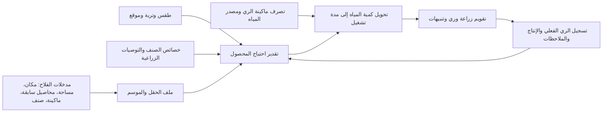

# خريطة استكمال مشروع AgriWater

**آخر مراجعة:** 25 أكتوبر 2026  
**النطاق:** منصة إرشاد تفاعلية لمزارع الأرز في كفر الشيخ، من اختيار الصنف حتى الحصاد، مع تحويل توصيات المياه إلى خطوات تشغيل مفهومة.

## صورة المشروع في سطر واحد

مدخلات الحقل والموسم + بيانات المكان والطقس والتربة + خصائص الصنف وماكينة الري ⟶ خطة زراعة وري حسب مراحل النمو ⟶ تذكيرات وإرشاد حتى الحصاد ⟶ تسجيل ما حدث ومقارنته بالخطة لتحسين التوصيات.

## ما أُنجز بالفعل

- **أساس جمع البيانات:** جامع لبيانات الحدود الإدارية والطقس وخصائص التربة ونقاط كتالوج صور Sentinel-2.
- **قاعدة بيانات SQLite:** مخطط منظم يشمل الطقس، التربة، أصناف الأرز، تقويم المحصول، معاملات المياه، الحقول، المواسم، تاريخ المحاصيل، ماكينات الري، وأحداث الري.
- **بيانات مناخية:** 777,024 سجلًا يوميًا للفترة 2017–2023 على 38 نقطة. هي بيانات شبكية/تقديرية وليست قياسًا داخل كل حقل.
- **أساس حساب مائي:** حساب ET0 وETc بمعاملات FAO-56 ومنحنى Kc عام، وسيناريوهات ري معلّمة بوضوح على أنها تقديرية.
- **أصناف:** جرى الآن تحميل 18 ملفًا مرجعيًا للأصناف من كتالوج قسم بحوث الأرز في ARC، مع تمييز قيم الكتالوج عن نتائج الحقول. بيانات سخا 109 المتعارضة تُركت فارغة بدل اختيار قيمة غير موثوقة.
- **تجارب ري منشورة:** أُضيفت 48 نتيجة بحثية لصنف جيزة 179 من تجارب محطة سخا لموسمي 2017 و2018: إنتاجية الحبوب وإنتاجية المياه حسب معاملة الري ومسافة الزراعة. هي نتائج تجارب وليست سجل فلاح، ولا تحتوي الجداول المستخرجة حجم الري المطلق لكل معاملة.
- **تجربة ري وتربة ومناخ إضافية:** أُضيفت 288 قيمة رقمية من تجربة سخا المنشورة لموسمي 2013 و2014 (Darwesh وآخرون، 2016): 144 قياسًا لمياه الري الموسمية والغلة وإنتاجية المياه ووزن الألف حبة حسب الصنف/الفترة/عمق الغمر، و64 قيمة لملف التربة 0–60 سم، و80 قيمة من ملخصات المناخ الشهرية. مياه الري تشمل تجهيز الأرض والمشتل والتأسيس؛ القيم مرجعية لمحطة وليست دقائق تشغيل أو توقعًا لحقل المستخدم.
- **مكونات الاحتياج المائي وقياس ET الفعلي:** أُضيفت 144 مشاهدة من تجربة سخا لموسمي 2012 و2013 (Moursi وAbdelkhalek، 2015): طقس شهري بالمحطة، تبخر-نتح فعلي بقياس lysimeter، ETo/ETc وفق طرق تقدير مختلفة، مكونات ميزانية الماء، ومياه موسمية وإنتاجية مائية لثلاثة أصناف. هي تجارب محطة؛ وحدات سرعة الرياح بالمصدر ملتبسة، والنتائج لا تمثل تصرف مضخات أو قياسات مزرعة.
- **مياه وغلة حديثة حسب فترة الري:** أُضيفت 22 قيمة من جدول 8 لدراسة سخا 106 بموسمي 2022 و2023 (Ghazy وآخرون، 2024): إجمالي المياه م³/هكتار، الغلة طن/هكتار، وفر الماء وكفاءة استخدامه لمعاملات الري كل 4/8/12 يومًا. المتوسطات هامشية عبر معاملات السماد/السيليكات في تجربة المحطة وليست نتائج كل تركيبة أو ريات مزارعين.
- **دراسة إقليمية أحدث للزراعة وعمق الري:** أُضيفت 54 قيمة من جدول 3 لدراسة موسمي 2023 و2024 في شمال الدلتا: المياه والغلة وإنتاجية المياه لتسع تركيبات من طريقة الزراعة × عمق الري. لا يذكر هذا المقتطف موقع المحطة أو الصنف، لذا تحفظ كدليل إقليمي ولا تُربط بحقل كفر الشيخ.
- **توصيات ARC:** جدول `agronomy_recommendation` يحتوي 23 قاعدة: 18 قاعدة/مقتطفًا من توصيات ARC الحديثة و5 قواعد للمشتل من نشرة 2025. من بينها قواعد تخص البذر الجاف ولا تُطبق على الشتل تلقائيًا. توجد 7 قواعد إضافية من صحافة ثانوية في `ministry_rule` موسومة `SECONDARY_PRESS_UNVERIFIED` ومستبعدة من التوصية التشغيلية لحين العثور على أصل رسمي.
- **دليل أصناف مؤرخ:** أُضيفت 13 بطاقة صنف من توصيات مايو 2025 المنسوبة لقطاع الإرشاد الزراعي، ببيانات النضج والإنتاجية المنشورة ومسافات الشتل والتحمل حيث وردت. خُزنت في جدول منفصل عن كتالوج ARC، لأن القيم قد تختلف حسب الإصدار ومصدر التوصية.
- **ماكينات الري المنشورة:** أُضيفت 6 صفوف مواصفات لعائلات مضخات Suteksan SEP 6/7/8 بوصة عند 50/60 هرتز، وسطر واحد من حصر وزارة الزراعة للمضخات الثابتة والنقالة لعام 2023. مواصفات الكتالوج ليست تصرفًا تشغيليًا، ومستوى المكان في سطر الحصر يحتاج تأكيدًا.
- **قالب إدخال:** استبيان لموسم حقل واحد يشمل الموقع والمساحة والصنف وماكينة الري وتواريخ الزراعة وثلاثة محاصيل سابقة وبيانات إنتاج/ري اختيارية.
- **تفسير المحاصيل السابقة:** أُضيف جدول مرجعي من 7 محاصيل شائعة حول سخا لتوحيد الأسماء العربية/الإنجليزية، الموسم المعتاد، والمجموعة الوظيفية (مثل البرسيم البقولي مقابل القمح/الذرة). هذا يساعد ETL على فهم التسلسل، لكنه لا يحوّل اسم البرسيم إلى كمية نيتروجين متبقية أو جرعة سماد.
- **مراجع تشغيلية:** يوجد مستورد للاستبيان يتحقق من البيانات قبل إدخالها، وجداول مهيأة لتسجيل الريات.
- **مؤشرات التغطية القابلة للتحقق:** الطقس 777,024 قيمة يومية (38 نقطة × 8 متغيرات × 2,556 يومًا) للفترة 2017–2023؛ سجل الأدلة المنشورة 688 مشاهدة/متوسطًا: 104 من تجربة كفر الشيخ 2007، و20 من محطة سخا 2016–2017، و20 من محطة بالدقهلية 2000–2001، و288 من تجربة سخا 2013–2014، و144 من تجربة سخا 2012–2013، و22 من تجربة سخا 2022–2023، و54 من دراسة شمال الدلتا 2023–2024، و36 من تجربة الكرادة 2014–2015. تضم هذه المراجع محاصيل/مياه/تربة/مناخ، ولا تمثل سجلات حقول المستخدمين. إحصاءات مساحة وإنتاج الأرز لها مصادر أولية للسنوات 7/7 (2017–2023). لا توجد سجلات حقول أو ريات أو غلة مزارعين.

## ما لم يُنجز بعد — الفجوات التي تمنع تجربة الفلاح

| الجزء | الموجود | المطلوب لإكماله |
|---|---|---|
| واجهة الفلاح | لا توجد واجهة موقع/تطبيق ظاهرة في ملفات المشروع | شاشة تسجيل الحقل والموسم، خريطة سهلة، لوحة خطة الموسم، وصفحة متابعة وتنبيهات |
| موقع وحدود الحقل | نقاط شبكية وحقول قاعدة البيانات تسمح بموقع/حدود، لكن لا توجد حقول فعلية؛ الاستيراد الحالي لا يحفظ مضلع القطعة | اختيار نقطة أو رسم حدود القطعة، حفظ المساحة/الوحدة، حساب مركز القطعة وربطه بأقرب طقس/تربة مع إظهار أن الربط تقديري |
| التربة والموقع | HWSD2 + متوسطات تجارب منشورة: تجربة كفر الشيخ تقارن قمح/برسيم سابق للأرز، وbaseline عناصر محطة سخا | لا نملك تحليلًا خاصًا بقطعة الفلاح ولا تغطية موزعة كافية لاستيفاء المحافظة. المطلوب طبقة خصوبة مكانية/عينات منشورة متعددة المواقع مع العمق وطريقة التحليل، وحدود تفسير NPK/EC المناسبة للمحصول |
| الصنف والشتلة | أسماء أصناف وبعض مرجع ARC؛ لا تكفي لتوليد تقويم زراعة كامل لكل صنف | تقويم رسمي للصنف، مدة النمو، مواعيد البذر والشتل، مراحل النمو، صفات الإنتاج، ومعاملات الاحتياج المائي ومصدر كل قيمة |
| ماكينة الري | 6 صفوف لعائلات مضخات Suteksan منشورة + حصر إداري واحد من الوزارة؛ لا يوجد حتى الآن منحنى نقطة تشغيل مرتبط بماكينة حقل | جمع موديلات الشركات ومنحنيات الأداء الدقيقة، ثم ربط الموديل برفع/ضغط المواسير وقياس التصرف الفعلي؛ بيانات الشركة والحصر لا تكفي وحدها لحساب دقائق تشغيل الفلاح |
| توصيات الري | سيناريوهات إجمالية تقديرية ونتائج تجربة منشورة لجيزة 179؛ لا توجد ريات مزارعين فعلية أو أحجام ري مطلقة للتجربة المستخرجة أو جداول مناوبات | قواعد ري حسب مرحلة النمو والطقس والتربة، ومصدر المياه/مواعيد الدور، ثم تحويل التوصية إلى وقت تشغيل مفهوم |
| المحاصيل السابقة | الاستبيان يدعم آخر 3 محاصيل وسنواتها ومواسمها؛ جدول `crop_reference` يوحّد 7 محاصيل؛ أضيفت تجارب عن البرسيم/القمح السابقة للأرز ودراسة 15 موقعًا قرب سخا عن تكرار الأرز والملوحة | حفظ ترتيب السنوات والموسم، واشتقاق الفئة الوظيفية. تجارب الدلتا تقوي قاعدة الأدلة، لكن دليل NPK من الدقهلية لا يمثل كفر الشيخ. لا يكفي اسم المحصول وحده لحساب NPK المتبقي أو جرعة السماد، ولا يعوض تحليل التربة |
| جدول الموسم والتنبيه | لا توجد آلية تنبيه أو سجل خطة زراعة منشور للفلاح | مولد تقويم من تاريخ البذر/الشتل، حفظ المهام، تعديلها بالطقس الفعلي، وتنبيه داخل الموقع أو SMS/WhatsApp بعد اختيار وسيلة مناسبة |
| التحقق من النتائج | 266 ملخص نقطة/موسم لكن لا توجد تسميات حقلية جاهزة؛ جداول الحقول والري الفعلي فارغة | تسجيل حجم/مدة كل رية والإنتاج والحصاد، ثم اختبار التوصيات على بيانات مستقلة قبل وصفها بأنها موفرة للمياه أو رافعة للإنتاج |
| المصادر | بعض بيانات المصدر ناقصة التوثيق، وبعض قواعد الوزارة موسومة بأنها تحتاج تأكيدًا | مصدر وتاريخ تحديث ووحدة وطريقة قياس لكل قاعدة أو رقم، واستبدال قواعد الصحافة بتوصيات رسمية مؤكدة قبل عرضها كإرشاد |

## ربط مدخلات الفلاح بقاعدة البيانات

1. **مكان الأرض:** `field.latitude` و`field.longitude` ويفضل `field.polygon_geojson`؛ يستخدم لربط الحقل بالطقس والتربة والإدارة المحلية. حدود الحقل ليست هي نقطة الشبكة.
2. **المساحة:** `field.area_feddan`، مع مساحة الأرز المزروعة للموسم في `field_season.cultivated_area_feddan`.
3. **آخر 3 محاصيل:** سجلات منفصلة في `crop_history` مرتبطة بالحقل والسنة ونوع الموسم والاسم الأصلي، ومعها `crop_code` موحد يملؤه ETL عند مطابقة الاسم في `crop_reference`.
4. **ماكينة الري:** `pump_type` لمواصفات الماكينة، ثم `field_season.pump_id` لربطها بموسم الحقل. أهم قيمة لحساب الدقائق هي التصرف الفعلي، لا الاسم أو القدرة وحدهما.
5. **الصنف الذي ينوي زراعته:** `field_season.variety_id`، لكن يلزم تمييز الموسم المخطط عن الموسم المكتمل حتى لا تختلط التوصية بسجل تاريخي.
6. **كل رية:** `irrigation_event` لتاريخ الري وحجمه/مدته وطريقة القياس؛ هذه السجلات ضرورية لمعايرة الخطة.

## بيانات النسخة التي تدخل نموذج التوصية

| مجموعة البيانات | الحقول التي يحتاجها النموذج | وضعها الآن ومصدرها |
|---|---|---|
| الحقل | الإحداثيات/حدود القطعة، المساحة ووحدتها، المركز الإداري | تدخل من الفلاح؛ لا توجد حقول فعلية مخزنة بعد. النقطة/الحدود تربط الحقل بالمصادر المكانية، ولا تعتبر حدًا مساحيًا رسميًا. |
| المناخ اليومي والموسمي | الحرارة العظمى/الصغرى، الرطوبة، الإشعاع، الرياح، المطر، ثم التوقع للأيام القادمة | 2017–2023 متاح من NASA POWER على 38 نقطة. يلزم تمديد الأرشيف بأحدث بيانات منشورة وإضافة مصدر توقعات؛ الشبكة ليست رصدًا مباشرًا في قطعة الفلاح. |
| التربة والموقع | القوام والعمق والكثافة وpH وEC/الملوحة والمادة العضوية وN/P/K/Zn والمياه الجوفية/الصرف عند توافرها | HWSD2 يغطي خصائص خرائطية محدودة؛ أُضيفت قيم منشورة من 4 دراسات/تجارب تشمل ملف تربة محطة سخا 0–60 سم. النقص الأساسي: خريطة/عينات محلية موزعة لمغذيات التربة مع العمق وطريقة التحليل وحدود التفسير. لا تحوّل متوسط محطة أو قيمة من محافظة مجاورة إلى قيمة حقل. |
| تاريخ المحاصيل | أسماء المحاصيل الثلاثة، السنة، موسم شتوي/صيفي، وترتيبها الزمني | المدخل يأتي من الفلاح؛ `crop_history` ما زال بلا سجلات. تجربة محلية تقارن البرسيم والقمح قبل الأرز، لكنها لا تعطي علاقة تكفي لاستنتاج NPK المتبقي من اسم المحصول وحده. |
| الصنف والتقويم | الصنف، طريقة الزراعة، موعد البذر/الشتل، عمر الشتلة، مراحل النمو، واحتياج الصنف | 18 مرجع صنف و23 قاعدة توصية موجودة، لكن ينقص تقويم محلي رسمي كامل لكل صنف/طريقة وموسم، وتوفر التقاوي الفعلي. |
| الماء والري | نوع المصدر، نظام الري ومناوبة القناة، ETc/المطر الفعال، عمق الماء، الفواقد/الكفاءة، الرشح حسب التربة وإدارة الحقل | يوجد ETc وسيناريو عام؛ لا توجد ريات فلاحين أو جداول مناوبات محافظة موثقة داخل DB. معامل الرشح الحالي نطاق أدبي عام، لا قياس محلي. |
| المضخة والتحويل إلى دقائق | الموديل، تصرف عند الرفع/الضغط الفعلي، الرفع الكلي، المواسير، المساحة، وحجم/عمق المياه المطلوب | 6 صفوف كتالوج عائلات مضخات؛ ينقص منحنى موديل محدد ونقطة تشغيل موثقة. «نوع الماكينة» وحده لا يكفي للحساب الدقيق. |
| نتائج التحقق | كمية المياه الفعلية/مدتها، السماد والعمليات المنفذة، موعد الحصاد، الغلة وطريقة القياس | بيانات الحقول فارغة. تجارب المحطات والأبحاث تصلح أدلة مقارنة، لكنها لا توفر تغطية كافية لتدريب نموذج مزرعي ممثل لكل كفر الشيخ. |

الموديل الموثوق يحتاج هذه البيانات في شكل جداول ذات مصدر وتاريخ ووحدة وحالة (`measured`, `published_trial`, `mapped_estimate`, `derived`, `missing`). جمع قيم مرجعية منشورة يكمل قاعدة المعرفة، لكنه لا يصنع وحده بيانات حقلية مفقودة ولا يبرر وعدًا بكمية سماد أو دقائق ري دقيقة.

## نبدأ التنفيذ بهذا الترتيب

### المرحلة 1 — تثبيت مدخلات الحقل والموسم

- توحيد قالب الاستبيان ومخططه البرمجي وعدم تغيير القالب من جامع البيانات.
- دعم حدود القطعة في الاستيراد وربطها بمركز مكاني واضح.
- فصل **موسم مخطط** عن **موسم منفذ**، وإضافة حالة الموسم وتاريخ إنشاء الخطة.
- تعريف قائمة موحدة لماكينة الري والمحاصيل السابقة والأصناف.

### المرحلة 2 — بناء محرك الخطة الزراعية

- جمع/توثيق قواعد رسمية للصنف ومواعيد البذر والشتل ومراحل النمو.
- إنشاء تقويم أولي قابل للتعديل، يعرض التواريخ والتعليمات ومصدر كل توصية.
- بناء حاسبة تشغيل ماكينة الري من التصرف المقاس، مع تقدير معلن وحدود عدم اليقين.
- عدم إرسال تنبيه ري آلي قبل توثيق القاعدة التي أنتجته ومراجعتها زراعيًا.

### المرحلة 3 — واجهة وتنبيهات

- واجهة عربية بسيطة تعمل على الهاتف، تبدأ بإنشاء الحقل ثم إعداد الموسم.
- شاشة «ماذا أفعل اليوم؟» مع سبب التوصية ومصدرها.
- تنبيهات قابلة للتعديل والإيقاف، ولا تعتمد على تاريخ ثابت إذا تغيرت ظروف الموسم.

### المرحلة 4 — القياس والتحسين

- تسجيل الري الفعلي ومدته ومصدر القياس، ثم الإنتاج وتاريخ الحصاد.
- مقارنة الخطة بالتنفيذ والنتيجة، والتحقق من وفورات المياه والإنتاجية قبل توسيع الادعاءات.

## ما أُضيف في دفعة جمع البيانات الحالية

### تدقيق جودة البيانات وإصلاحها — 25 أكتوبر 2026

- تقرير التغطية والجودة التفصيلي: `reports/AgriWater_Data_Audit_2026-10-25.md`.
- مصدر كل سنة لإحصاءات الأرز محفوظ الآن في حقلي `source_url` و`source_status` في `regional_stats`، ومعه ملف مراجعة `data/processed/regional_stats_source_audit.csv`.
- بيانات الطقس تغطي 38 نقطة × 8 متغيرات يومية دون فجوات زمنية من 2017 إلى 2023؛ هي بيانات شبكة وليست قراءات حقلية.
- عولجت قيمة nodata السالبة في التربة، وفُصلت النطاقات العددية عن القيم المفردة في معاملات المياه.
- حُدّث تقسيم مراحل نمو الأرز في حساب سيناريو المياه إلى 30/30/60/30 يومًا، وأعيد حساب الجدول حسب الصنف. لا تزال المخرجات افتراضية وغير معايرة بقياس ري محلي.
- لا تعتبر قاعدة البيانات مكتملة 100%: لا توجد سجلات ري أو غلة على مستوى الحقل، ولا ملوحة أو عمق ماء أرضي، ولا نقاط تشغيل فعلية لمضخات المزارعين. تفاصيل النقص والحدود موضحة في التقرير.

- استكمال ملف صفات الأصناف من **18 سجلًا** في كتالوج قسم بحوث الأرز بـARC، بدل 4 سجلات سابقة.
- تحميل السجلات إلى `rice_variety` و`rice_variety_reference` عبر `import_arc_rice_varieties.py`، مع تسجيل المصدر وتاريخ الاستخراج ونسخة آمنة من قاعدة البيانات.
- استبعاد الصفات المتضاربة لصنف سخا 109، وعدم إدخال جيزة 184 لأن صفحة الكتالوج تعرض اسمه من دون ملف صفات.
- مصدر الكتالوج لا يثبت وحده أن الصنف معتمد أو متاح للتقاوي في موسم بعينه، ولا يقدم احتياج المياه أو مواعيد زراعة محلية.
- تحميل **48 نتيجة** من تجربة منشورة بمحطة بحوث سخا إلى جدولي `literature_study` و`literature_trial_result`، في مسار منفصل عن بيانات المزارعين.
- نتائج التجربة مفيدة كمرجع مقارنة بين الغمر والري كل 6 أو 9 أيام، لكنها لا تكفي لحساب زمن تشغيل ماكينة الفلاح؛ حجم الري المطلق لكل معاملة غير موجود في الجداول المستخرجة.
- تحديث `data/processed/rice_recommendations_arc.csv` وجدول `agronomy_recommendation` إلى 23 قاعدة موثقة النطاق والمصدر، تتضمن إرشادات ARC منشورة في 2026 وقواعد المشتل من 2025. الإرشادات الخاصة بالبذر الجاف معزولة عن الشتل. قواعد `ministry_rule` السبعة المستندة إلى تغطية صحفية معلّمة غير مؤكدة وغير مستخدمة تشغيليًا.
- إضافة توصيات عامة للبذور والمشتل ومقتطفات التسميد من نشرة مايو 2025، و13 بطاقة صنف إلى `rice_variety_field_guide_2025.csv` وجدول `rice_variety_field_guide`. تبقى بيانات هذه النشرة منفصلة عن خصائص كتالوج ARC لتسهيل إظهار اختلاف المصدر والتاريخ.
- إضافة 6 مواصفات لعائلات مضخات Suteksan عند 50/60 هرتز إلى `pump_catalog_suteksan.csv` وجدول `pump_catalog_series`. التصرف الأقصى والرفع الأقصى حدود منفصلة لعائلة المنتج وليسا نقطة تشغيل متزامنة.
- إضافة صف حصر وزارة الزراعة لعام 2023 المسمى «كفر الشيخ» إلى `machinery_inventory_ministry.csv` وجدول `machinery_inventory`. سُجلت أعداد الثابت والنقال كما ظهرت، مع وضع مستوى المكان «يحتاج تأكيدًا» قبل استخدامه في ربط المراكز.
- إضافة 104 قيمة/متوسطًا من جداول دراسة El-Henawy المنشورة عن تجربة أرز 2007 بمزرعة كلية الزراعة بجامعة كفر الشيخ (المحصول السابق: قمح/برسيم؛ عمقا 0–30 و30–60 سم؛ معاملات التلوي/بدونه). أضيفت إلى `literature_trial_observation` وملف `data/processed/kfs_rice_previous_crop_soil_trial_2007.csv` منفصلة عن تربة الحقول. الدراسة وجدت اختلافات في بعض خواص التربة، بينما فروق الغلة بين المعاملات لم تكن معنوية إحصائيًا.
- إضافة 20 قيمة baseline منشورة لخصائص وخصوبة تربة محطة بحوث الأرز بسخا لعامي 2016 و2017 (قوام، EC، pH، مادة عضوية، N الكلي، P/K/Zn المتاح) إلى الجدول نفسه و`data/processed/sakha_rice_soil_baseline_2016_2017.csv`. العمق غير منشور في جدول الدراسة؛ لذلك ترك فارغًا. هذه قيم محطة بحث لا تقديرًا لقطعة الفلاح.
- إضافة 20 قيمة من تجربة إقليمية في الدقهلية لعامي 2000–2001 تقارن تربة ما بعد البرسيم والقمح (N/P/K/pH) ومتوسط غلة الأرز، في `data/processed/delta_rice_previous_crop_nutrients_2000_2001.csv`. ليست بيانات كفر الشيخ، ولا تُستخدم كتوصية جرعة تسميد.
- إضافة ETL مستقل قابل لإعادة التشغيل لكل مجموعة، مع مصدر الدراسة ورقم الجدول والحالة المرجعية ونسخة احتياطية قبل الاستيراد.
- إضافة سجل دليل نوعي في `literature_evidence`: تجربة كفر الشيخ لم تجعل فروق الغلة بعد البرسيم/القمح معنوية إحصائيًا، ودراسة 15 موقعًا قرب سخا لم تجد أثرًا معنويًا لتكرار الأرز على الملوحة، بينما أشارت إلى دور الموقع والصرف وجودة مياه الري. هذا يمنع ترميز علاقة crop-history بسيطة كأنها قانون عام.
- إضافة `crop_reference` و`data/processed/crop_reference_kafr_el_sheikh.csv` لتوحيد أسماء البرسيم والقمح والذرة والأرز والقطن وبنجر السكر والشعير. عُدّل `crop_history` ليحفظ الاسم الذي أدخله المستخدم و`crop_code` الموحّد؛ الوظيفة تطبيع الإدخال وتجهيز ميزات ETL، لا تقدير مغذيات التربة رقميًا.
- إضافة 20 متوسطًا من تجربة دقهلية/الدلتا لعامي 2000–2001 تقارن N/P/K/pH بعد البرسيم أو القمح وغلة الأرز، محفوظة كدليل إقليمي في `literature_trial_observation`؛ تُفصل عن بيانات كفر الشيخ ولا تستخدم كتوصية تسميد محلية.
- إضافة 36 قيمة من جدول 8 لدراسة Abou El Hassan (2017) بمحطة الكرادة، موسما 2014 و2015، تشمل إجمالي مياه الري والغلة ونقص الغلة ووفر الماء وWUE لمعاملات الغمر المستمر وحجب الري 12 يومًا عند مراحل مختلفة. حُفظ اختلاف قيمة وفر الماء 2014 لمعاملة التفريع المتوسط (6.33% في الجدول مقابل 6.37% في الملخص) لصالح الجدول مع تسجيله كتعارض مصدر. الملف `data/processed/abou_el_hassan_karada_water_deficit_2014_2015.csv` وسكربت `import_abou_el_hassan_karada_2014_2015.py`.
- يتكرر استيراد هذه المراجع بأمان عبر `import_reference_data.py` مع نسخة احتياطية وفحص سلامة SQLite ومفاتيح الربط.

## أول إصلاح بنيوي

عولج تعارض مهم في `src/collector.py`: كان إنشاء قالب الاستبيان يكتب مخططًا مبسطًا فوق المخطط المعتمد، بينما `import_field_survey.py` يحتاج مخططًا تفصيليًا. أصبح الجامع يقرأ أسماء الأعمدة من المخطط المعتمد ولا يستبدله، ويترك أي قالب موجود كما هو حفاظًا على البيانات.

## معيار إنجاز النسخة الأولى

يستطيع الفلاح إنشاء حقل، تحديد مساحته وموقعه، إدخال محاصيله السابقة، اختيار صنف وماكينة بتصرف معروف، ثم يحصل على تقويم موسم واضح وخطة تشغيل ري قابلة للتعديل، ويستطيع تسجيل ما نفذه. كل توصية تعرض مصدرها وتوضح إن كانت تقديرية أو مؤكدة، ولا ندعي توفير المياه أو زيادة الإنتاج قبل قياس ذلك.
