# مخطط ERD وقارئ العلاقات — AgriWater

هذا الملف يعرض طبقتين مختلفتين في المشروع:

1. **قاعدة المصدر العلاقية:** جداول تشغيلية/مرجعية تحفظ سجلات المصدر والربط بينها. رسمها الكامل مستخرج من مفاتيح SQLite الخارجية الـ48.
2. **المستودع التحليلي النجمي:** أبعاد وصفية مشتركة تتصل بجداول حقائق مختلفة. رسمه مولد من تعريف SQL الفعلي في `AgriWater_Clean_Data/schema/star_schema.sql`، ويعرض مفاتيح الأبعاد والحقائق وعلاقاتها.

## كيف تقرأ الرموز؟

- `||` تعني سجلًا واحدًا في جهة الجدول الأب.
- `o{` تعني صفرًا إلى عدة سجلات في الجهة التابعة؛ قد تكون الجداول التابعة فارغة حاليًا.
- اسم العلاقة بعد النقطتين هو عمود المفتاح الخارجي في الجهة التابعة.
- المربعات تُظهر المفتاح الأساسي الاصطناعي. بقية الأعمدة وأنواعها موجودة في `schema.sql` أو `star_schema.sql` وقواميس البيانات.
- ERD يوضح البنية والربط، ولا يعني أن كل الجداول تحتوي صفوفًا فعلية. سجلات الحقول والري الفعلي فارغة حتى الآن.

## أ. ERD قاعدة المصدر العلاقية

هذا الرسم يوضح علاقات الجداول المسجلة فعليًا بالمفاتيح الخارجية. يركز على العلاقات؛ قائمة الأعمدة الكاملة في `AgriWater_Clean_Data/schema/data_dictionary.csv`.

```mermaid
erDiagram
  data_source ||--o{ canal_schedule : "source_id"
  season ||--o{ canal_schedule : "season_year"
  district ||--o{ canal_schedule : "district_id"
  rice_variety ||--o{ crop_calendar : "variety_id"
  season ||--o{ crop_calendar : "season_year"
  crop_reference ||--o{ crop_history : "crop_code"
  field ||--o{ crop_history : "field_id"
  rice_variety ||--o{ crop_water_parameter : "variety_id"
  district ||--o{ district : "parent_id"
  district ||--o{ field : "district_id"
  grid_point ||--o{ field : "point_id"
  field_season ||--o{ field_operation : "field_season_id"
  pump_type ||--o{ field_season : "pump_id"
  irrigation_method ||--o{ field_season : "irrigation_method_id"
  rice_variety ||--o{ field_season : "variety_id"
  season ||--o{ field_season : "season_year"
  field ||--o{ field_season : "field_id"
  district ||--o{ grid_point : "district_id"
  data_source ||--o{ groundwater_level : "source_id"
  district ||--o{ groundwater_level : "district_id"
  grid_point ||--o{ groundwater_level : "point_id"
  field_season ||--o{ irrigation_event : "field_season_id"
  literature_study ||--o{ literature_environmental_measurement : "study_id"
  literature_study ||--o{ literature_evidence : "study_id"
  literature_study ||--o{ literature_trial_observation : "study_id"
  rice_variety ||--o{ literature_trial_result : "variety_id"
  literature_study ||--o{ literature_trial_result : "study_id"
  district ||--o{ ministry_rule : "district_id"
  rice_variety ||--o{ ministry_rule : "variety_id"
  grid_point ||--o{ point_season_summary : "point_id"
  season ||--o{ point_season_summary : "season_year"
  district ||--o{ regional_stats : "district_id"
  season ||--o{ regional_stats : "season_year"
  grid_point ||--o{ rice_daily_water_demand : "point_id"
  rice_variety ||--o{ rice_variety_field_guide : "variety_id"
  rice_variety ||--|| rice_variety_reference : "variety_id"
  data_source ||--o{ sentinel2_scene : "source_id"
  sentinel2_scene ||--|| sentinel2_shortlist : "scene_id"
  grid_point ||--|| soil_awc : "point_id"
  grid_point ||--|| soil_point : "point_id"
  data_source ||--o{ soil_salinity : "source_id"
  grid_point ||--o{ soil_salinity : "point_id"
  sentinel2_scene ||--o{ vegetation_index : "scene_id"
  grid_point ||--o{ vegetation_index : "point_id"
  grid_point ||--o{ water_scenario : "point_id"
  season ||--o{ water_scenario : "season_year"
  data_source ||--o{ weather_daily : "source_id"
  grid_point ||--o{ weather_daily : "point_id"
```

## ب. ERD مستودع Star Schema

الأبعاد المشتركة، مثل التاريخ والموقع والموسم والصنف والمقياس والمصدر، ترتبط بكل حقيقة بحسب مستوى التفصيل الخاص بها. لا تربط حقائق مختلفة مباشرةً؛ اربطها عبر أبعاد مشتركة مع الانتباه إلى grain كل حقيقة.

```mermaid
erDiagram
  DIM_DATE {
    INTEGER date_key PK
  }
  DIM_ADMIN_AREA {
    INTEGER admin_area_key PK
  }
  DIM_LOCATION {
    INTEGER location_key PK
  }
  DIM_SEASON {
    INTEGER season_key PK
  }
  DIM_CROP {
    INTEGER crop_key PK
  }
  DIM_VARIETY {
    INTEGER variety_key PK
  }
  DIM_STUDY {
    INTEGER study_key PK
  }
  DIM_SOURCE {
    INTEGER source_key PK
  }
  DIM_METRIC {
    INTEGER metric_key PK
  }
  DIM_TREATMENT {
    INTEGER treatment_key PK
  }
  DIM_SAMPLE_CONTEXT {
    INTEGER sample_context_key PK
  }
  DIM_WATER_MODEL {
    INTEGER water_model_key PK
  }
  DIM_SOIL_UNIT {
    INTEGER soil_unit_key PK
  }
  DIM_PUMP_SERIES {
    INTEGER pump_series_key PK
  }
  DIM_IRRIGATION_METHOD {
    INTEGER irrigation_method_key PK
  }
  DIM_FIELD {
    INTEGER field_key PK
  }
  DIM_PUMP {
    INTEGER pump_key PK
  }
  FACT_WEATHER_DAILY {
    INTEGER weather_fact_key PK
  }
  FACT_SOIL_MEASUREMENT {
    INTEGER soil_fact_key PK
  }
  FACT_DAILY_CROP_WATER {
    INTEGER crop_water_fact_key PK
  }
  FACT_SEASONAL_WATER_SCENARIO {
    INTEGER water_scenario_fact_key PK
  }
  FACT_REGIONAL_CROP_STAT {
    INTEGER regional_stat_fact_key PK
  }
  FACT_TRIAL_RESULT {
    INTEGER trial_result_fact_key PK
  }
  FACT_TRIAL_OBSERVATION {
    INTEGER trial_observation_fact_key PK
  }
  FACT_ENVIRONMENTAL_MEASUREMENT {
    INTEGER environmental_fact_key PK
  }
  FACT_LITERATURE_EVIDENCE {
    INTEGER evidence_fact_key PK
  }
  FACT_CROP_CALENDAR {
    INTEGER calendar_fact_key PK
  }
  FACT_VARIETY_FIELD_GUIDE {
    INTEGER variety_guide_fact_key PK
  }
  FACT_CROP_WATER_PARAMETER {
    INTEGER crop_water_parameter_fact_key PK
  }
  FACT_AGRONOMY_GUIDANCE {
    INTEGER guidance_fact_key PK
  }
  FACT_PLANT_PROTECTION_GUIDANCE {
    INTEGER protection_fact_key PK
  }
  FACT_PUMP_CATALOG {
    INTEGER pump_catalog_fact_key PK
  }
  FACT_SATELLITE_SCENE {
    INTEGER scene_fact_key PK
  }
  FACT_MACHINERY_INVENTORY {
    INTEGER machinery_fact_key PK
  }
  FACT_POINT_SEASON_SUMMARY {
    INTEGER point_season_fact_key PK
  }
  FACT_BASELINE_WATER_SCENARIO {
    INTEGER baseline_scenario_fact_key PK
  }
  FACT_FIELD_SEASON {
    INTEGER field_season_fact_key PK
  }
  FACT_IRRIGATION_EVENT {
    INTEGER irrigation_event_fact_key PK
  }
  FACT_FIELD_OPERATION {
    INTEGER field_operation_fact_key PK
  }
  FACT_CROP_HISTORY {
    INTEGER crop_history_fact_key PK
  }
  FACT_CANAL_SCHEDULE {
    INTEGER canal_schedule_fact_key PK
  }
  FACT_GROUNDWATER_LEVEL {
    INTEGER groundwater_fact_key PK
  }
  FACT_SOIL_SALINITY {
    INTEGER soil_salinity_fact_key PK
  }
  FACT_VEGETATION_INDEX {
    INTEGER vegetation_index_fact_key PK
  }
  DIM_ADMIN_AREA ||--o{ DIM_ADMIN_AREA : parent_admin_area_key
  DIM_ADMIN_AREA ||--o{ DIM_LOCATION : admin_area_key
  DIM_LOCATION ||--o{ DIM_FIELD : location_key
  DIM_ADMIN_AREA ||--o{ DIM_FIELD : admin_area_key
  DIM_DATE ||--o{ FACT_WEATHER_DAILY : date_key
  DIM_LOCATION ||--o{ FACT_WEATHER_DAILY : location_key
  DIM_SOURCE ||--o{ FACT_WEATHER_DAILY : source_key
  DIM_METRIC ||--o{ FACT_WEATHER_DAILY : metric_key
  DIM_LOCATION ||--o{ FACT_SOIL_MEASUREMENT : location_key
  DIM_SOIL_UNIT ||--o{ FACT_SOIL_MEASUREMENT : soil_unit_key
  DIM_METRIC ||--o{ FACT_SOIL_MEASUREMENT : metric_key
  DIM_DATE ||--o{ FACT_DAILY_CROP_WATER : date_key
  DIM_LOCATION ||--o{ FACT_DAILY_CROP_WATER : location_key
  DIM_CROP ||--o{ FACT_DAILY_CROP_WATER : crop_key
  DIM_SEASON ||--o{ FACT_SEASONAL_WATER_SCENARIO : season_key
  DIM_LOCATION ||--o{ FACT_SEASONAL_WATER_SCENARIO : location_key
  DIM_VARIETY ||--o{ FACT_SEASONAL_WATER_SCENARIO : variety_key
  DIM_WATER_MODEL ||--o{ FACT_SEASONAL_WATER_SCENARIO : water_model_key
  DIM_SEASON ||--o{ FACT_REGIONAL_CROP_STAT : season_key
  DIM_ADMIN_AREA ||--o{ FACT_REGIONAL_CROP_STAT : admin_area_key
  DIM_CROP ||--o{ FACT_REGIONAL_CROP_STAT : crop_key
  DIM_SOURCE ||--o{ FACT_REGIONAL_CROP_STAT : source_key
  DIM_STUDY ||--o{ FACT_TRIAL_RESULT : study_key
  DIM_SEASON ||--o{ FACT_TRIAL_RESULT : season_key
  DIM_VARIETY ||--o{ FACT_TRIAL_RESULT : variety_key
  DIM_TREATMENT ||--o{ FACT_TRIAL_RESULT : treatment_key
  DIM_METRIC ||--o{ FACT_TRIAL_RESULT : metric_key
  DIM_STUDY ||--o{ FACT_TRIAL_OBSERVATION : study_key
  DIM_SEASON ||--o{ FACT_TRIAL_OBSERVATION : season_key
  DIM_CROP ||--o{ FACT_TRIAL_OBSERVATION : crop_key
  DIM_METRIC ||--o{ FACT_TRIAL_OBSERVATION : metric_key
  DIM_STUDY ||--o{ FACT_ENVIRONMENTAL_MEASUREMENT : study_key
  DIM_SEASON ||--o{ FACT_ENVIRONMENTAL_MEASUREMENT : season_key
  DIM_SAMPLE_CONTEXT ||--o{ FACT_ENVIRONMENTAL_MEASUREMENT : sample_context_key
  DIM_METRIC ||--o{ FACT_ENVIRONMENTAL_MEASUREMENT : metric_key
  DIM_STUDY ||--o{ FACT_LITERATURE_EVIDENCE : study_key
  DIM_CROP ||--o{ FACT_LITERATURE_EVIDENCE : crop_key
  DIM_SEASON ||--o{ FACT_CROP_CALENDAR : season_key
  DIM_VARIETY ||--o{ FACT_CROP_CALENDAR : variety_key
  DIM_VARIETY ||--o{ FACT_VARIETY_FIELD_GUIDE : variety_key
  DIM_CROP ||--o{ FACT_CROP_WATER_PARAMETER : crop_key
  DIM_VARIETY ||--o{ FACT_CROP_WATER_PARAMETER : variety_key
  DIM_SOURCE ||--o{ FACT_CROP_WATER_PARAMETER : source_key
  DIM_CROP ||--o{ FACT_AGRONOMY_GUIDANCE : crop_key
  DIM_VARIETY ||--o{ FACT_AGRONOMY_GUIDANCE : variety_key
  DIM_ADMIN_AREA ||--o{ FACT_AGRONOMY_GUIDANCE : admin_area_key
  DIM_SOURCE ||--o{ FACT_AGRONOMY_GUIDANCE : source_key
  DIM_CROP ||--o{ FACT_PLANT_PROTECTION_GUIDANCE : crop_key
  DIM_SOURCE ||--o{ FACT_PLANT_PROTECTION_GUIDANCE : source_key
  DIM_PUMP_SERIES ||--o{ FACT_PUMP_CATALOG : pump_series_key
  DIM_DATE ||--o{ FACT_SATELLITE_SCENE : acquired_date_key
  DIM_SOURCE ||--o{ FACT_SATELLITE_SCENE : source_key
  DIM_SOURCE ||--o{ FACT_MACHINERY_INVENTORY : source_key
  DIM_SEASON ||--o{ FACT_POINT_SEASON_SUMMARY : season_key
  DIM_LOCATION ||--o{ FACT_POINT_SEASON_SUMMARY : location_key
  DIM_SEASON ||--o{ FACT_BASELINE_WATER_SCENARIO : season_key
  DIM_LOCATION ||--o{ FACT_BASELINE_WATER_SCENARIO : location_key
  DIM_FIELD ||--o{ FACT_FIELD_SEASON : field_key
  DIM_SEASON ||--o{ FACT_FIELD_SEASON : season_key
  DIM_VARIETY ||--o{ FACT_FIELD_SEASON : variety_key
  DIM_IRRIGATION_METHOD ||--o{ FACT_FIELD_SEASON : irrigation_method_key
  DIM_PUMP ||--o{ FACT_FIELD_SEASON : pump_key
  DIM_DATE ||--o{ FACT_FIELD_SEASON : sowing_date_key
  DIM_DATE ||--o{ FACT_FIELD_SEASON : transplanting_date_key
  DIM_DATE ||--o{ FACT_FIELD_SEASON : harvest_date_key
  FACT_FIELD_SEASON ||--o{ FACT_IRRIGATION_EVENT : field_season_fact_key
  DIM_DATE ||--o{ FACT_IRRIGATION_EVENT : event_date_key
  FACT_FIELD_SEASON ||--o{ FACT_FIELD_OPERATION : field_season_fact_key
  DIM_DATE ||--o{ FACT_FIELD_OPERATION : operation_date_key
  DIM_FIELD ||--o{ FACT_CROP_HISTORY : field_key
  DIM_SEASON ||--o{ FACT_CROP_HISTORY : season_key
  DIM_CROP ||--o{ FACT_CROP_HISTORY : crop_key
  DIM_ADMIN_AREA ||--o{ FACT_CANAL_SCHEDULE : admin_area_key
  DIM_SEASON ||--o{ FACT_CANAL_SCHEDULE : season_key
  DIM_DATE ||--o{ FACT_CANAL_SCHEDULE : start_date_key
  DIM_DATE ||--o{ FACT_CANAL_SCHEDULE : end_date_key
  DIM_SOURCE ||--o{ FACT_CANAL_SCHEDULE : source_key
  DIM_LOCATION ||--o{ FACT_GROUNDWATER_LEVEL : location_key
  DIM_ADMIN_AREA ||--o{ FACT_GROUNDWATER_LEVEL : admin_area_key
  DIM_DATE ||--o{ FACT_GROUNDWATER_LEVEL : date_key
  DIM_SOURCE ||--o{ FACT_GROUNDWATER_LEVEL : source_key
  DIM_LOCATION ||--o{ FACT_SOIL_SALINITY : location_key
  DIM_DATE ||--o{ FACT_SOIL_SALINITY : date_key
  DIM_SOURCE ||--o{ FACT_SOIL_SALINITY : source_key
  DIM_LOCATION ||--o{ FACT_VEGETATION_INDEX : location_key
  FACT_SATELLITE_SCENE ||--o{ FACT_VEGETATION_INDEX : scene_fact_key
```

## نقاط مهمة في التصميم

- مصدر البيانات العلاقي يحفظ تفاصيل المصدر والمراجع ويخدم التحديث والتحقق.
- Star Schema مشتق منه للتحليل، وليس بديلًا عن قاعدة المصدر. كود البناء في `AgriWater_Clean_Data/etl/build_star_schema.py`.
- `fact_weather_daily` و`fact_daily_crop_water` يوميان؛ بينما `fact_seasonal_water_scenario` موسمي وبحسب الموقع والصنف ونسخة الحساب. لا تجمعهم قبل توحيد الفترة والمستوى.
- قياسات الدراسة المنشورة تحفظ تحت الدراسة والمقياس والمعاملة وتظل منفصلة عن بيانات الحقل الفعلية.
- جداول `fact_field_season` و`fact_irrigation_event` و`fact_field_operation` و`fact_crop_history` موضوعة لاستيعاب بيانات الحقول مستقبلًا، لكنها فارغة في نسخة المشروع الحالية.
- مستويات الصف وقواعد التحويل موضحة في `AgriWater_Clean_Data/schema/star_fact_grain.csv` و`AgriWater_Clean_Data/metadata/star_etl_profile.csv`.

للتلخيص الوظيفي والبيانات والنواقص، افتح `AgriWater_Project_Summary_Arabic.md`. وللتدقيق التفصيلي، راجع تقارير `AgriWater_Clean_Data/reports/` وملف `AgriWater_Clean_Data/metadata/manual_review_queue.csv`.